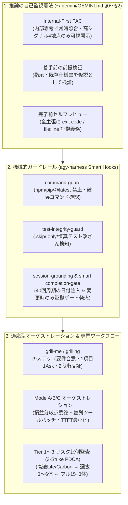

# Antigravity Multi-Agent Setup (JA)

[](./LICENSE)
[-orange.svg)](./CONTRIBUTING.md)
[](#-v13-アップデート-gemini-4-carbon-高速化省トークン最適化)

Google **Antigravity** 上で、**推論の自己監視（Internal-First PAC・前提検証・確信度校正）**、**機械的ガードレール（スマート Hooks）**、**リスク比例 Tier 1〜3 複眼セカンドオピニオン（3-Strike PDCA）**、**9ステップの段階的要件定義（Grill-Me / Grilling）**、および **Gemini 4 Carbon / Flash / Claude のモデル適応オーケストレーション** を即座に再現するための個人運用セットアップ集です。

> [!NOTE]
> **📖 オープン公開ポリシー（閲覧・利用・Fork 自由 / PR 受付なし）**
> 本リポジトリは [@Haratakeshi](https://github.com/Haratakeshi) 個人の日常開発環境をオープンに共有するリファレンスです。MIT ライセンスのもとで**複製・導入・Fork・改変は完全に自由**ですが、個人の運用スタイルと密結合しているため **Pull Request や Issue は受け付けておりません**（[CONTRIBUTING.md](./CONTRIBUTING.md) 参照）。ぜひご自身のアカウントへ Fork してカスタマイズしてください！

---

## 🆕 v1.3 アップデート: Gemini 4 Carbon 高速化・省トークン最適化

実稼働トランスクリプト91件と Language Server ログのプロファイリングに基づき、安全境界と品質規律を一切削らずに **トークン消費量と体感待ち時間を大幅削減するアップデート** を反映しました：

1. **Internal-First PAC 化（出力トークン中央値 `-59.4%` 削減）**:
   - 毎ステップの定型宣言（`目的 / 予測 / 照合: OK`）による「二重 CoT 課金」を廃止し、通常推論を `<thought>` に一本化。可視出力は **高シグナル4地点**（①着手前の前提検証、②サプライズ発生時、③Human Gate、④完了前セルフレビュー）のみに集中。
2. **常時ロード5ルールの高密度ダイエット（`40KB → 約19.8KB`, `-50%+` 圧縮）**:
   - 全23サブエージェントにも注入されるルール群を半分以下に圧縮し、プロンプトキャッシュ効率（実測 `98.4%`）と初動速度を改善。
3. **Carbon レイテンシ最適化規律 ＆ 並列バッチ読取の徹底**:
   - Carbon の固定 TTFT（7〜20秒/手）が累積する「1ファイル1ターンの逐次ループ」を禁止し、**1ターン複数並列ツール発行**（監査役は1ターン5〜15ファイル一括読取・往復上限つき）を徹底。
   - **損益分岐点（Break-Even）委譲基準**: 3ファイル以内の読取・10秒以内の単発コマンドはメイン Carbon が直接実行し、重いビルド/全テスト・4ファイル以上の広域調査のみ Flash へ委譲。
   - 内部 Safety Monitor の同期 LLM 審査（`+1.5〜7秒`）を誘発する不要な複合シェル演算子（`&&`, `;`, `|`）の回避、および `150k tokens` 到達時の `/compact` 指針を明文化。
4. **リスク・速度比例の 3段階レビュースケーリング（Tier 1〜3）**:
   - 毎回15体をフル起動せず、**Tier 1**（日常: 高速な `second-opinion-lite` / 重要箇所は `carbon-verifier`）、**Tier 2**（重要変更: ドメイン選抜 3〜6体＋Stage 2）、**Tier 3**（リリース前・3ストライク時: フル 15+3体）を自動使い分け。
5. **Antigravity v2.30+ スマート Stop Hooks ＆ 未追跡バイナリ放置ガード**:
   - 質問応答・調査のみ（実ファイル変更なし）の会話や、既に `<!-- GOAL_COMPLETE -->` 出力済みの応答では無駄な引き止めターンを発生させず即時 `allow` 素通し化。`transcript.jsonl` の二重クォート引数展開および Round 2 `send_message` 再監査の自動認識にも対応。
   - コミット済みバイナリ（画像・音声・配布データ等）は一切妨げず、スクリプト等で**未追跡（`??`）のまま大量放置されたバイナリ/圧縮ファイル（30件以上）**のみを検知し、Language Server の UTF-8 差分生成ストームを未然に防止。

**既存環境からのアップデート方法**（初回導入時のバックアップベースラインはそのまま安全に保持されます）：
```bash
cd antigravity-multiagent-setup-ja
git pull
python3 scripts/install.py
# process-review-gate や Claude Code 用 grilling も導入済みの場合は:
# python3 scripts/install.py --with-process-gate --with-claude-skills
```

---

## 🚀 最速セットアップ（他の Antigravity に丸投げするだけ）

新しい PC や別の Antigravity 環境を開き、チャット欄に**次の1文を貼るだけ**でセットアップが完了します：

```text
https://github.com/Haratakeshi/antigravity-multiagent-setup-ja をクローンして、リポジトリ内の AGENTS.md を読んで私の Antigravity 環境をセットアップして。
```
（すでにローカルにクローン済みの場合は：*「`/path/to/antigravity-multiagent-setup-ja` の中身を見てセットアップして」* と伝えるだけで OK です。）

### 手動コマンドで導入する場合（Python 3 標準ライブラリのみ・外部依存ゼロ）

```bash
git clone https://github.com/Haratakeshi/antigravity-multiagent-setup-ja.git
cd antigravity-multiagent-setup-ja

# 1. 環境診断（OS, Node, pnpm, uv, Claude CLI の有無と代替モード確認）
python3 scripts/install.py --check

# 2. ドライラン確認（書き込みなし）
python3 scripts/install.py --dry-run

# 3. インストール実行（既存の ~/.gemini 設定は ~/.gemini/backups/setup-baseline/ に自動退避されます）
python3 scripts/install.py

# オプション: Node.js 製の src/ 監査ゲート + Claude Code 用 grilling スキルも同時導入する場合
python3 scripts/install.py --with-process-gate --with-claude-skills
```

- **再起動不要**: `~/.gemini/config/plugins/` への配置により、次のターンから自動でロードされます。
- **ワンコマンド復元**: 元に戻したいときは `python3 scripts/uninstall.py` で直前のバックアップ状態へ復元できます。

---

## 🧠 この環境の基本理念（なぜこれが効くのか）

AI コーディングにおける典型的な失敗（「指示の誤前提を鵜呑みにする」「存在しない API を捏造する」「テストを `.skip` や期待値書き換えでごまかす」「同じバグ修正を3回以上空回りして視野狭窄に陥る」「サブエージェントの生ログや1ファイルずつの逐次読取で時間とコンテキストが溶ける」）を、**プロンプトの心がけだけでなく「構造・並列バッチ規律・機械的ゲート」で防ぐ**設計になっています。



より詳しい設計背景は [docs/PHILOSOPHY.md](./docs/PHILOSOPHY.md) を参照してください。

---

## 📦 同梱されているプラグイン・スキル・ツール一覧

### 1. コア憲法 (`gemini/GEMINI.md`)
| 節 | 内容 |
|---|---|
| **§0 Reasoning Protocol** | Internal-First PAC（高シグナル4地点開示）、サプライズの昇格、**3ストライク視点リセット**（`mindfulness` → `ask-opus`/`senior-architect-advisor` または `multi-agent-opinion` モードB）、着手前の前提検証、証拠出自に基づく確信度校正、完了前セルフレビュー |
| **§1 Output Discipline** | 自己評価の証拠義務（コマンド＋exit code / `file:line`）、機能ベースの役割名、迎合抑止（疑問文の中立解釈） |
| **§2 Side-Effect Boundary** | 書き込み境界、不可逆・外部送信操作の Human Gate（`pending_human_review`）、Chrome 144+ DevTools 直結デッドロック禁止 |

### 2. 常時展開プラグイン (`gemini/config/plugins/`)

| プラグイン名 | 役割・主な機能 | 同梱スキル / サブエージェント |
|---|---|---|
| **`agy-harness`** | 実装規律（§4〜§11）＋ 5種の機械的 Lifecycle Hooks | `second-opinion-lite` ＋ 5 Python Hooks（`guard_commands`, `guard_file_edits`, `guard_urls`, `session_context`, `stop_selfreview`） |
| **`multi-agent-kit`** | 監査独立性規律（§3）＋ Tier 1〜3 リスク比例 3-Strike PDCA レビューパイプライン | スキル: `multi-agent-opinion`, `mindfulness`, `visual-verification-loop`<br>サブエージェント: ステージ1専門レビュアー15体 ＋ ステージ2複眼監査3体 ＋ `second-opinion-lite` ＋ `web-production-readiness-reviewer` ＋ `stripe-billing-readiness-reviewer` ＋ `visual-verification-reviewer` |
| **`multi-axis-investigation-kit`** | 1つの発見で探索を止めない直交多軸調査・内外両面観測・反証チェック | スキル: `multi-axis-investigation` |
| **`claude-orchestrator-kit`** | メインモデル別の損益分岐点分業・レイテンシ最適化（Mode A/B/C）と軍師・出口監査ゲート | スキル: `ask-opus`, `claude-exit-review`<br>サブエージェント: `carbon-verifier`, `senior-architect-advisor`, `flash-runner`, `flash-implementer`, `flash-investigator`, `flash-e2e-verifier` |

### 3. 日常ワークフロー単体スキル (`gemini/config/skills/` & `tools/`)

| スキル名 | 使いどころ |
|---|---|
| **`grill-me` / `grilling`** | `/grill-me` または `/grilling` で起動。場当たり的な小出し質問やゴール未合意の TODO 化を禁止し、**「①初期調査 → ②ゴール合意Ask → ③複数軸調査 → ④方針Ask（1項目1Ask・セクション混同禁止） → ⑤詳細調査 → ⑥調査反証レビュー → ⑦TODO詳細Ask（1項目1Ask） → ⑧Plan反証レビュー＆確定 → ⑨実装開始」** の9ステップを徹底します。 |
| **`package-supply-chain`** | JavaScript/TypeScript での `pnpm`、Python での `uv`、固定バージョンと lockfile 同期の具体的なコマンド置換表。 |
| **`antigravity-project-setup`** | 新規プロジェクト開始時に「このプロジェクトを Antigravity 用に初期化して」と頼むと、`~/.agent/antigravity-project-setup/setup.js` を実行してプロジェクト専用の `GEMINI.md`・`AGENTS.md`・`.agents/plugins/project-agent-kit/` 一式を生成します。 |

---

## 🔄 モデル適応オーケストレーション (Mode A / B / C)

`claude-orchestrator-kit` は、あなたが Antigravity のモデルピッカーで選んだメインモデルに合わせて自動で立ち回りを切り替えます：

- **Mode A: `Gemini 4 Carbon`（または `Argon`）選択時【主力推奨】**
  - **メイン（Carbon 直接実行）**: 要件分解・設計判断・コアロジック実装・**3ファイル以内の読取/grep**・**10秒以内の単発コマンド**・スクリーンショット最終目視判定を直接高速処理（1ターン並列ツールバッチ必須）。
  - **Flash ワーカー群**: 長大ログのフルビルド・全テスト実行（`flash-runner`）、**4ファイル以上/複数軸の並列コード調査**（`flash-investigator`）、スコープ明確な定型実装（`flash-implementer`）へ委譲し、Carbon の思考トークン浪費と待ち時間（TTFT）を最小化。
- **Mode B: `Gemini Flash` 選択時**
  - 日常の軽微な改修や単発タスクをサブエージェント起動オーバーヘッドなしで最速直接実行。難所のみ `Model: "pro"` で上位サブエージェントを召喚。
- **Mode C: `Claude`（Antigravity 内蔵 Opus / Sonnet）選択時**
  - 入口（要件分解・設計）と出口（最終反証レビュー）だけを Claude が担い、中間の調査・実装・テスト実行をすべて Flash サブエージェントに任せることで Claude クオータを大幅に節約。

---

## 🛡️ 外部ツールが存在しない環境での自動代替（フォールバック設計）

他の PC で **Claude Code CLI (`claude`)** やブラウザ拡張 **`cdp-relay`** が入っていなくても、**すべてのワークフローがエラーにならず内蔵機能だけで完結**します：

| 機能・スキル | 外部ツール導入済み環境の挙動 | 外部ツール未導入環境の自動代替挙動 |
|---|---|---|
| **`ask-opus`**（軍師・設計相談） | 外部 `claude` CLI 経由で Claude Opus に読み取り専用相談 | 内蔵サブエージェント **`senior-architect-advisor`** を起動（メインが内蔵 Opus/Sonnet/Carbon なら `Model: "inherit"`、Flash なら `Model: "pro"`） |
| **`claude-exit-review`**（出口反証監査） | 外部 `claude` CLI 経由で Claude Sonnet が差分＋画像を監査 | 内蔵サブエージェント **`carbon-verifier`** を起動し、同じクリーンルーム条件で差分＋画像を高速バッチ監査 |
| **`multi-agent-opinion` Stage 2** | `sonnet_inspect.py` で Claude Sonnet が指摘を再検査 | 内蔵サブエージェント **`mindfulness-inspector`** が指摘を `file:line` 照合し `CONFIRMED / UNVERIFIED / REJECTED` に分類 |
| **ブラウザ確認・画面撮影** | `cdp-relay`（ログイン済み Chrome/Edge セッション中継） | Antigravity 標準内蔵の **`browser` サブエージェント** または Playwright ヘッドレス実行へ自動切替（※デッドロックする `chrome_devtools` 直結は常時ブロック） |

詳細は [docs/CUSTOMIZATION_GUIDE.md](./docs/CUSTOMIZATION_GUIDE.md) をご覧ください。

---

## 🧪 リポジトリの自己検証

ルールファイルの 24,000 バイト上限チェック、個人情報・固有パスのゼロ件スキャン、JSON / YAML frontmatter / Python / Node 構文チェック、各種 Hook 動作テスト（v2.30+ 二重クォート引数・Round 2 `send_message` 再監査対応含む）、および隔離ディレクトリへのインストール＆アンインストール往復テストを1コマンドで実行できます：

```bash
python3 scripts/verify.py
```

---

## 📄 ライセンス

[MIT License](./LICENSE) © 2026 Haratakeshi
