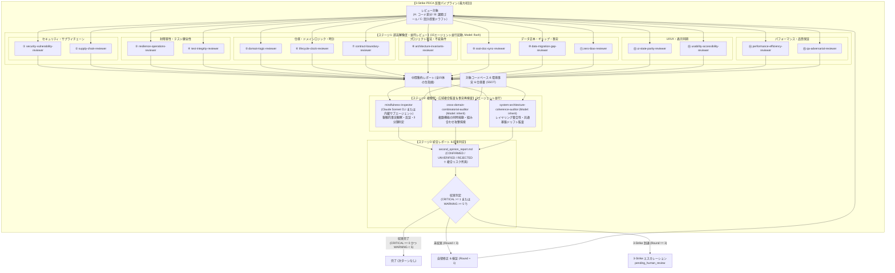

# Multi-Agent Second Opinion Review Skill（複眼型・超高解像度マルチエージェントオピニオン）

このスキルは、メインエージェント（Antigravity）が自らの推論、設計提案、またはコード実装に対して、**【ステージ1: 15体の超高解像度・単一責任専門レビュアーによる並行検査】** と **【ステージ2: 3エージェントによる複眼型・広域複合監査＆マインドフルネス事実再検査】** の多層パイプラインを実行し、多角的な「セカンドオピニオン」を客観的事実に基づいて取得・検証するための手順書です。

本スキルは単発（1回）のレビューで終わらせず、**不具合が収束するまで最大3回（3-Strike Rules）自動的に「レビュー → 判定 → 修正 → 再レビュー」のPDCAサイクルを回すことをデフォルトの挙動**とします。CRITICALが残存している場合や重大なWARNINGが多数（5件以上）残っている場合は次ターンを実行し、CRITICALが解消されINFOレベルのみ（または軽微なWARNING 5件未満）に収束した時点でレビューを完了します。

---

## パイプライン構成概要



---

## 0. 設定値

| キー | 値 |
|---|---|
| レビュータイムアウト（ステージ1） | 180 秒 |
| 再検査タイムアウト（ステージ2） | 180 秒 |
| INFO 出力上限（通常レビュアー） | 5 件 |
| 差分サイズ上限（1分割あたり） | 500 行 / 20 KB |
| **デフォルト反復上限（3-Strike Rules）** | **最大 3 ラウンド**（全タスク共通デフォルト） |
| **次ターン再実行トリガー** | `[CONFIRMED]` な `CRITICAL >= 1` または `WARNING >= 5` |
| **収束完了トリガー（次ターンなし）** | `[CONFIRMED]` な `CRITICAL == 0` かつ `WARNING < 5`（INFOのみ等）、または指摘 0 件 |
| **エスカレーショントリガー** | 3ラウンド実行後も未収束（`CRITICAL >= 1` または `WARNING >= 5`） |

---

## 1. 起動モード

| モード | トリガ | サブエージェントに渡すもの | 出力形式 |
|---|---|---|---|
| **A: 成果物レビュー** | コミット前 / PR 前 / リファクタ後 / 重要更新後 | クリーンルーム入力: マスク済みの差分または対象ファイル ＋ 不変条件仕様（Invariants Spec / docs / API契約）。※作成側の思考ログ・試行履歴・言い訳は一切渡さない | `[CATEGORY: ...] [LEVEL] [file:line](url) - description + concrete fix` |
| **B: 発想転換（3 ストライク）** | GEMINI.md §0.2 の 3 ストライク | 達成したい課題（ゴール）と対象コードのパスのみ | `[CATEGORY: ...] [DIRECTION: 方針名] description + rationale` |
| **C: 設計提案ドラフト反証** | 実装着手前の設計方針決定 / UX再設計提案 / アーキテクチャ変更計画 | 提案ドラフト本文 ＋ 解決すべき症状/要望 ＋ 現行コード・仕様書のパス | `[CATEGORY: ...] [VERDICT: REFUTED / SURVIVED / GAP] [file:line](url) - premise flaw + alternative` |

- **モード A**: 作成側の思考プロセスを渡さず、純粋な「Git差分」と「対象機能の不変条件仕様（Invariants Spec）」のみを渡すクリーンルーム原則（§3.4）を厳守します。
- **モード B**: メインエージェントは「達成したいゴール」と「対象コードのパス」のみを各サブエージェントに渡し、失敗ログ・真因仮説・試行履歴は一切渡しません（§0.2 状況遮断）。機密ファイル（`.env*`、鍵ファイル等）は除外します。
- **モード C**: 実装前に「症状の真因と提示案のズレ」「二者択一の偽のジレンマ」「陳腐化したドキュメント依存」「現状コードの事実誤認」を敵対的に反証し、REFUTED / SURVIVED / GAP に分類します。

---

## 2. ステージ1: 専門レビュアー一覧（15エージェント並行起動, `Model: "flash"`）

本プラグインの `agents/` 配下に事前登録されている以下の15体をすべて並行起動します（選別・スキップ禁止）：

1. **`security-vulnerability-reviewer`**: インジェクション、認証・セッション、認可/IDOR/BaaSルール、秘密情報漏洩、暗号化
2. **`supply-chain-reviewer`**: `pnpm` / `uv` 規律遵守、固定バージョン、lockfile同期、依存脆弱性、ライセンス
3. **`resilience-operations-reviewer`**: 空catch排除、ログとPII保護、リソース回収、タイムアウト・リトライ冪等性、整合性境界
4. **`test-integrity-reviewer`**: テスト通過用のプロダクション汚染（ハック・広域catch・型名マッチ）排除、モック健全性
5. **`domain-logic-reviewer`**: ドメインロジック適合性、境界値・エッジケース（null/zero/極大値/TZ）、状態遷移整合性
6. **`lifecycle-clock-reviewer`**: 多重ライフサイクル・時計（Clock/Timer）の分離、イベント発火順序、状態遷移更新の対称性
7. **`contract-boundary-reviewer`**: API契約一貫性、モジュール境界、ライフサイクルトランジションのバイパス（状態直接代入）検知
8. **`architecture-invariants-reviewer`**: 決定論的処理（順序保証データ構造、乱数シード・時刻注入隔離）、マジックナンバー外部化
9. **`ssot-doc-sync-reviewer`**: Doc-Code Literal Sync（完全一致）、正本仕様（SSOT）・最新マイルストーンとの照合
10. **`data-migration-gap-reviewer`**: データ分割・移行時の二重管理（SSOT分裂・旧ファイル残存）検知、デッドコード排除
11. **`zero-bias-reviewer`**: 主観的確信度0%による現状コード実態（`file:line`）反証、思い込み・誤前提の排除
12. **`ui-state-parity-reviewer`**: UI表示計算式とロジック層計算式の二重化（乖離）排除、リアルタイム状態同期
13. **`usability-accessibility-reviewer`**: UX、WCAG 2.1/2.2 AA、レスポンシブ、常時可視レイヤー確保、偽のジレンマ打破
14. **`performance-efficiency-reviewer`**: N+1クエリ、無制限メモリ肥大化、並行処理競合・レースコンディション、ホットパス計算量
15. **`qa-adversarial-reviewer`**: 敵対的シナリオ・極限境界値、状態遷移パス網羅性、欠落テストの優先順位付け

（※Webサービス公開前やStripe決済監査では、追加で同梱の `web-production-readiness-reviewer` / `stripe-billing-readiness-reviewer` も起動可能です。）

---

## 3. ステージ2: 複眼型・広域複合監査＆事実再検査（3系統並行）

ステージ1の全15エージェントの指摘結果を受け取り、以下の3視座から並行検証します：

1. **`mindfulness-inspector`（事実再検査・3分類判定）**:
   - **優先ルート（外部 `claude` CLI 導入環境）**: `sonnet_inspect.py` を実行し、別モデルファミリー（Claude Sonnet）の視点で `file:line` 照合・反証・`CONFIRMED / UNVERIFIED / REJECTED` 判定を実行。
   - **自動代替ルート（外部 `claude` CLI 未導入環境）**: `sonnet_inspect.py` が終了コード `2`（`[FALLBACK_TO_NATIVE_SUBAGENT]`）を返した場合、直ちに `invoke_subagent` で内蔵サブエージェント **`mindfulness-inspector`**（メインが Carbon/Argon/内蔵Claude なら `Model: "inherit"`、Flash なら `Model: "pro"`）を起動して同じく3分類判定を完遂します。
2. **`cross-domain-combinatorial-auditor`（組み合わせ攻撃・複合作用監査、`Model: "inherit"`）**:
   - 複数機能（例：FSM状態遷移＋非同期タイムアウト到達＋在庫/残高減算＋キャンセル割り込み＋再試行発火）が同時に重なった極限状態での創発バグ・競合・状態デッドロック・副作用干渉を探索。
3. **`system-architecture-coherence-auditor`（システム全体整合性・調和監査、`Model: "inherit"`）**:
   - レイヤリング境界と依存方向、共通基盤と個別ロジックの一本化（DRY・正本保護）、アーキテクチャドリフトの有無を広域監査。

---

## 4. 実行手順（Step-by-Step）

### ステップ 1: レビュー対象コンテンツの抽出とマスク（モード A）
1. 差分（`git diff HEAD` 等）または対象ファイルを特定します（`.env*`, `*.pem`, `*.key`, `*secret*` 等の機密ファイルは除外）。
2. テキスト内の認証情報・APIキー等を `[REDACTED]` にマスクし、scratch 領域（`<appDataDir>/brain/<conversation-id>/scratch/`）に一時保存します。
3. 差分が極大の場合はモジュール単位に分割して反復します。

### ステップ 2: 【ステージ1】15体の専門レビュアー並行起動 (`invoke_subagent`)
1. 全15体を `Model: "flash"` で並行起動します。
2. `schedule` ツール（`DurationSeconds=180`, `TimerCondition="never"`）でタイムアウトを設定し、ツール呼び出しを止めて Reactive Wakeup を待機します。
3. 全応答が揃ったらタイマーを `manage_task` (`kill`) で解除し、中間集約レポートを作成します（全15体が `[CLEAN]` ならステージ2を省略して完了）。

### ステップ 3: 【ステージ2】3系統の複眼監査＆事実再検査
中間集約レポートを基に、(a) と (b) を並行実行します：

**(a) マインドフルネス事実再検査**:
```bash
python3 ~/.gemini/config/plugins/multi-agent-kit/skills/multi-agent-opinion/scripts/sonnet_inspect.py \
  --findings <ステージ1全指摘.md> --target <対象ファイル/ディレクトリ> \
  --repo <作業ディレクトリ> --out <artifactDir>/sonnet_inspection.md
```
- **フォールバック手順**: 上記コマンドが `exit code 2`（`claude` CLI 不在・未認証）を返した場合は、エラー停止せず即座に `invoke_subagent` で `TypeName: "mindfulness-inspector"`（`Model: "inherit"`、メインが Flash の場合は `"pro"`）を起動し、`<ステージ1全指摘.md>` と対象コードパスを渡して `[VERIFICATION: CONFIRMED / UNVERIFIED / REJECTED]` を取得します。

**(b) 複合リスク＆アーキテクチャ整合性監査**:
- `cross-domain-combinatorial-auditor` (`Model: "inherit"`) と `system-architecture-coherence-auditor` (`Model: "inherit"`) を `invoke_subagent` で並行起動します。

### ステップ 4: 【ステージ3】統合レポート生成 (`second_opinion_report.md`) と 3-Strike PDCA
1. 結果を統合し、`<appDataDir>/brain/<conversation-id>/second_opinion_report.md` に出力します（サブエージェント実行時は親から指定されたパスに出力し、直ちに5行以内のサマリを `send_message` で親へ返します）。
2. **収束判定**:
   - `[CONFIRMED]` な `CRITICAL >= 1` または `WARNING >= 5` → 自律修正・ビルド/テスト確認のうえ次ラウンド（最大3ラウンド）へ。
   - `CRITICAL == 0` かつ `WARNING < 5` → 収束完了。
   - Round 3 終了後も未収束 → 自動ループを停止し、`pending_human_review` として残存課題と選択肢をユーザーに提示。
3. **クリーンアップ**: タイマーおよび子サブエージェントを終了し、scratch のマスク済み一時ファイルは空上書きまたは `-f`/`-r` 無しの `rm <scratchファイルパス>` で安全に片付けます（`rm -f` による `guard_commands.py` の `force_ask` 停止を回避）。
