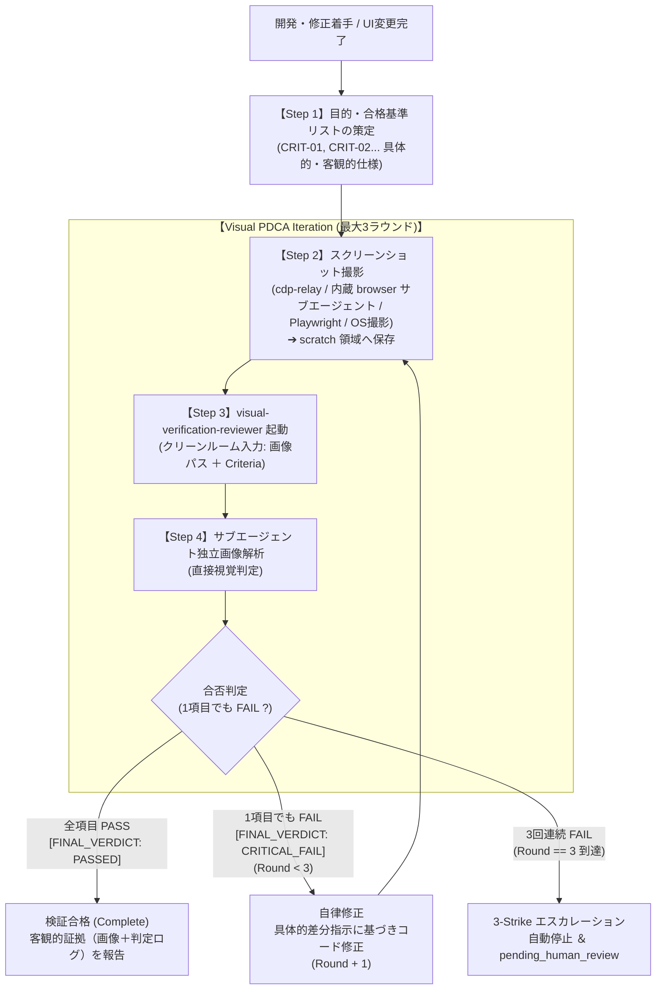

# Visual Verification Loop Skill (視覚的ゴール検証・自律PDCAイテレーション)

本スキルは、開発した Web UI、ゲーム画面、アプリ画面、GUI ウィジェットについて、**「スクリーンショット撮影 ➔ サブエージェントによる客観的画像解析 ➔ 独立中立な合否判定 ➔ 1項目でもNGなら CRITICAL 差し戻し ➔ 自律修正 ➔ 再撮影・再検証」** という厳格な PDCA 反復イテレーションを実行するための標準運用手順書です。

親エージェント自身の主観的思い込み（「修正したから大丈夫」「大体合っている」）を排除し、画像上の客観的エビデンスに基づくゼロ・トレランス（妥協ゼロ）品質保証を実現します。

---

## ワークフロー概要 (3-Strike PDCA Visual Loop)



---

## 運用設定値

| 設定項目 | 値 | 備考 |
|---|---|---|
| **最大反復ラウンド** | **3 ラウンド** | 3-Strike 規則に準拠。3回連続失敗時はエスカレーション |
| **判定合格条件** | **全項目 PASS (100%)** | 1項目でも FAIL があれば即座に `CRITICAL_FAIL` |
| **画像保存領域** | `<appDataDir>/brain/<conversation-id>/scratch/` | `visual_proof_r{round}.png` として保存 |
| **サブエージェント名** | `visual-verification-reviewer`（または最終判定時は `carbon-verifier`） | 画像視覚解析対応 |

---

## 実行手順（Step-by-Step）

### Step 1: 目的と合格基準（Invariants Criteria）の策定

検証を開始する前に、何を達成すべきかを**具体的・検証可能な項目（CRIT-ID）**として定義します。曖昧な表現（「きれいに」「見やすく」）を排除し、視覚的に判定できる仕様にします。

```markdown
### 目的 (Goal)
[機能名・画面名] の [状態/画面] が設計通りに正しく描画・配置されていることを検証する。

### 合格基準チェックリスト (Invariants Criteria)
- [CRIT-01] ヘッダータイトル: 画面上部に "XXXX" のテキストが明瞭に表示されていること。
- [CRIT-02] アクションボタン: 画面下部に配置され、他の要素と重なっていないこと。
- [CRIT-03] レイアウト・余白: 左右のマージンが均等に確保され、画面端で要素が切れていないこと。
- [CRIT-04] デバッグ表示排除: 一時的な枠線やダミーテキスト（Lorem ipsum）が残存していないこと。
```

### Step 2: スクリーンショットの撮影と保存（GEMINI.md §2.3 準拠）

> [!WARNING]
> Chrome / Edge 144+ における MCP `chrome_devtools` / `edge_devtools` 直結はモーダル承認ダイアログでデッドロックするため使用禁止です。

対象環境に応じて以下のいずれかでスクリーンショットを取得します：
- **パターン A（推奨・全環境共通）**: Antigravity 標準内蔵の **`browser` サブエージェント**、または Playwright 等の E2E ランナーで対象 URL を開いてスクリーンショットを保存する。
- **パターン B（`cdp-relay` 導入環境）**: MCP `cdp-relay` の `screenshot` ツール（または `browser` CLI）で既存プロファイル画面を撮影する。
- **パターン C（ネイティブアプリ / macOS）**: `screencapture -x <appDataDir>/brain/<conversation-id>/scratch/visual_proof_r1.png` 等で撮影する。

### Step 3: サブエージェント呼び出し (`invoke_subagent`)

親エージェントの思考プロセスや言い訳は一切渡さず、純粋な「画像の絶対パス」と「Step 1 で定義した合格基準リスト」のみを渡します。

```json
{
  "TypeName": "visual-verification-reviewer",
  "Role": "Visual-Goal-Verification-Audit",
  "Model": "flash",
  "Prompt": "以下の画像および合格基準に基づき、視覚的検証を実施してください。\n\n【検査対象画像】\nfile://<appDataDir>/brain/<conversation-id>/scratch/visual_proof_r1.png\n\n【合格基準チェックリスト】\n- [CRIT-01] ...\n- [CRIT-02] ...\n\n1項目でもNGがある場合は無条件で [FINAL_VERDICT: CRITICAL_FAIL] とし、具体的な修正指示を返してください。全項目が完全に達成されている場合のみ [FINAL_VERDICT: PASSED] を下してください。"
}
```
（※Gemini 4 Carbon オーケストレーターモードの最終ゲート目視確認では、`carbon-verifier` またはメイン自身が画像を確認します。）

### Step 4: PDCA 反復制御
- **`[FINAL_VERDICT: PASSED]`**: 全項目達成を確認し、画像パスと判定ログを証拠として完了報告（§1.1）。
- **`[FINAL_VERDICT: CRITICAL_FAIL]` (Round < 3)**: 指摘箇所を修正し、Step 2 へ戻って次ラウンドを撮影・再検証。
- **Round == 3 でも `CRITICAL_FAIL`**: 自動ループを停止し、`pending_human_review` でエスカレーション（§0.2）。
