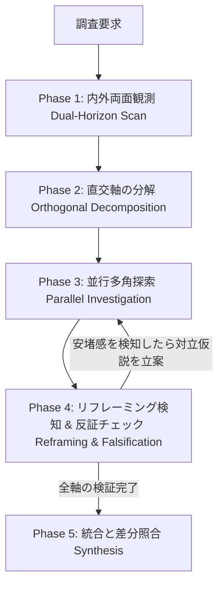

# Multi-Axis Investigation & Grounding Skill (多軸調査・探索スキル)

本スキルは、「1つの情報が見つかった時点で探索を終了してしまう認知的閉鎖（Premature Closure）」を排除し、Web調査およびコードベース探索において複数の直交軸を網羅的に検証するための標準プロトコルです。

---

## ワークフロー

### Phase 1: 内外両面観測 (Dual-Horizon Scan)
調査を開始する際、外部（Web/リモート）と内部（ローカル環境/コードベース）の双方から初期シグナルを抽出します。

- **Web調査の場合**:
  - 【内側】手元の利用可能スキル一覧、システムプロンプト、設定ファイル（`.gemini/`, `.agents/`）、インストール済みバイナリ（`--version`）を確認。
  - 【外側】公式ドキュメント、Changelog、Issueトラッカー、GitHubリポジトリを検索。
- **コードベース探索の場合**:
  - 【内側】対象モジュールの実装コード、型定義、設定ファイルを検索。
  - 【外側】呼び出し側のテストコード、他モジュールからのimport箇所、ドキュメント/READMEを検索。

### Phase 2: 直交軸の分解 (Orthogonal Decomposition)
1つの初期発見が得られたら、それを「唯一の解」とせず、直交する独立した系統を最低2軸定義します。

| 調査種別 | 軸1（主軸） | 軸2（直交軸A） | 軸3（直交軸B） |
|---|---|---|---|
| **バージョン・リリース調査** | デスクトップ/GUI版の推移 | CLI/ヘッドレス版の推移 | 手元の内蔵スキル/環境の差異 |
| **API / 仕様調査** | 最新安定版（Stable）の仕様 | プレビュー/Nightly版の仕様 | レガシー互換・移行パス |
| **バグ・障害調査** | 直接のエラー発生箇所 | 上流の入力データ・呼び出し元 | 設定・環境変数・OS差分 |
| **コード機能探索** | インターフェース・型定義 | コアロジック実装 | E2E/単体テスト・利用例 |

### Phase 3: 並行多角探索 (Parallel Investigation)
定義した各直交軸に対し、独立した視点（必要に応じて `flash-investigator` サブエージェント等を展開）で証拠を収集します。
- 軸ごとに `read_file` / `view_file`、`grep_search`、`search_web`、`run_command` を適切に使い分け、客観的証拠（file:line、URL、コマンドexit code）を取得します。

### Phase 4: リフレーミング検知 & 反証チェック (Reframing & Falsification)
「これで辻褄が合った」「全て説明できた」という安堵感が生じた瞬間をトリガーとして、強制的に以下の自己問答を行います：

1. **`[リフレーミング検知: 探索停止の危険]`** を出力。
2. **反証の提起（Devil's Advocate）**:
   - 「もし現在の結論が部分的な事実に過ぎないとしたら、何を見落としているか？」
   - 「別の系統（バージョン、モジュール、設定）で同時に動いているものはないか？」
3. 反証を検証するための追加探索を最低1手実行する。

### Phase 5: 統合と差分照合 (Synthesis & Delta Analysis)
すべての軸から得られた証拠を突き合わせ、全体像・差異・結論を構造化して出力します。

---

## 完了基準チェックリスト
- [ ] 1つの発見に飛びつかず、直交する複数軸を定義・検証したか？
- [ ] 内部（足元）と外部（全体）の両面を観測・照合したか？
- [ ] 安堵感による推論停止（リフレーミング）を検知し、反証ステップを挟んだか？
- [ ] すべての結論に客観的な証拠（URL、file:line、実行結果）が添えられているか？
