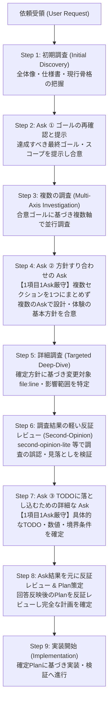

# Grill-Me: 段階的ゴール合意・方針すり合わせ・反証レビュー統合ワークフロー

ユーザーが `/grill-me`（`<GRILL_ME>`）を指定した際、または曖昧・複合的な要件のすり合わせを行う際は、内蔵 `<GRILL_ME>` の単純な「調査→1問Ask→調査→1問Ask」の小出しループを**禁止**し、必ず以下の **9ステップ・ワークフロー** を順番通りに実行してください。

---

## 解決する課題（絶対禁止のアンチパターン）

1. **ゴール未合意のままアクションリスト（TODO）や細部の質問から入ることを禁止**:
   - 最初の浅い調査だけで「どの関数をどう直すか」や最終プランの提示に飛びついてはならない。まず「何を実現するか（ゴール）」を合意する。
2. **「調査 → 小出しAsk → 調査 → 小出しAsk」の場当たり的ループを禁止**:
   - 体系的な調査なしに思いつきで質問を小出しに続けたり、間違った初期前提のまま質問を重ねることを禁止する。
3. **複数セクション・複数論点を1つの Ask 項目に詰め込むことを禁止**:
   - 異なるセクションや独立した設計判断を1つの質問文・選択肢にまとめてはならない。必ず **「1項目 1 Ask（1つのセクション・論点につき1つの独立した質問）」** に分割し、複数の Ask を実行して丁寧に方針をすり合わせる。
4. **反証レビュー（Second-Opinion）なしの思い込み進行を禁止**:
   - 調査結果の誤認や既存実装の見落としを抱えたまま TODO 質問や実装計画に進まないよう、要所で必ず反証レビューを挟む。

---

## 全体ワークフロー（9 Steps）

---

## 各ステップの実行規律

### Step 1: 初期調査（Initial Discovery）
- 依頼を受けたら、細部の実装方法を決め打ちせず、まず対象プロジェクトの全体像・関連仕様書（`docs/`、Issue 等）・現行コードの骨格を把握するための初期調査を行う。
- この段階の目的は「ユーザーが達成したい本質的なゴールと現状のギャップ」を正確に理解することにある。

### Step 2: Ask ① — ゴールの再確認と提示（Goal Alignment Ask）
- 初期調査の結果を踏まえ、まず **「本タスクで達成すべき最終ゴール（目的・完了状態の定義・対象スコープ・やらないこと）」** を明確に整理してユーザーに提示し、`ask_question` ツールでゴールの認識にズレがないか再確認する。
- ゴールの解釈やスコープに選択肢がある場合は、推奨案 `(Recommended)` を先頭に置いて提示する。
- **Gate**: ゴールの合意が完了するまで、各論の設計方針や TODO のすり合わせに進んではならない。

### Step 3: 複数の調査（Multi-Axis Investigation）
- Step 2 で合意したゴールを実現するために必要な **複数の調査軸**（例：①ドメインロジック・状態遷移、②UI/UX・演出・画面構造、③データ定義・永続化・マイグレーション、④既存資産・テスト・制約条件など）を立て、並行して調査を実行する（`flash-investigator` サブエージェントの並列起動や複数ツールの並行実行を活用）。
- コードやドキュメントを読めばわかる事実をユーザーに質問してはならない。事実調査はすべてエージェント側で完遂する。

### Step 4: Ask ② — 方針をすり合わせるための Ask（Policy Alignment Asks）
- Step 3 の複数調査で得られた事実をもとに、各セクション・領域の **「基本方針（どのアプローチ・仕様・体験を採用するか）」** をすり合わせるための Ask を実行する。
- **【最重要ルール：1項目 1 Ask・セクション分離】**:
  1. **1項目 1 Ask の徹底**: 1つの論点・1つのセクションにつき、必ず1つの独立した質問（Question）を作成する。
  2. **複数セクションの混同禁止**: 「セクションAの仕様とセクションBのUI」のように、複数のセクションや異なる決定事項を1つの Ask にまとめてはならない。
  3. **複数の Ask による丁寧なすり合わせ**: 論点が複数ある場合は、`ask_question` の `questions` 配列に「1項目＝1要素」として独立して並べるか、複数回の Ask に分けて、すべてのセクションの方針を漏れなくすり合わせる。
  4. **推奨回答の明示**: 各質問の選択肢（`options`）の先頭には必ず `(Recommended)` を付けた推奨案を置き、各選択肢のトレードオフや根拠（調査で確認した事実）を添える。

### Step 5: 詳細調査（Targeted Deep-Dive Investigation）
- Step 4 で合意した各セクションの基本方針に基づき、実際に変更・新規作成する対象ファイル、関数、行番号（`file:line`）、データスキーマ、呼び出し元の影響範囲、および既存テストの状況をピンポイントで詳細調査する。

### Step 6: 調査結果の軽い反証レビュー（Lightweight Second-Opinion on Investigation）
- Step 5 の詳細調査結果について、TODO 質問へ進む前に **`second-opinion-lite`（または `carbon-verifier` 等の独立サブエージェント／クリーンルーム反証）による軽い反証レビュー** を実施する。
- **検証ポイント**:
  - 「未実装だと思っていた機能が、実は別名や別モーダルですでに存在していないか？」
  - 「調査で特定した変更箇所だけで本当に足りるか？見落としている呼び出し元や副作用はないか？」
  - 「既存の不変条件（Invariants）や設計規約と衝突していないか？」
- 反証レビューで判明した事実や修正点を反映してから Step 7 へ進む。

### Step 7: Ask ③ — TODO に落とし込むための詳細な Ask（Detailed TODO Breakdown Asks）
- Step 6 の反証レビューを通過した正確な調査結果をもとに、**具体的な実装 TODO リスト（アクションアイテム）に落とし込む上で確定が必要な詳細仕様（具体的な数値、文言、境界値・エッジケースの挙動、フォールバック、優先順位など）** を `ask_question` で質問する。
- ここでも **「1項目 1 Ask（複数セクションを1つにまとめない）」** と **「推奨回答 `(Recommended)` の先頭配置」** を厳守する。

### Step 8: Ask 結果を元にした反証レビュー ＆ Plan 策定（Plan Refutation Review & Planning）
- Step 7 のユーザー回答をすべて統合し、具体的な実装計画（`implementation_plan.md` および実行可能な TODO リスト）を作成する。
- 作成した Plan が「Step 2 のゴール」「Step 4 の基本方針」「Step 7 の詳細指定」および「コードベースの不変条件」をすべて満たしているか、**Plan に対する反証レビュー（`carbon-verifier` / `second-opinion-lite` 等）** を行う。
- 反証レビューで指摘された抜け漏れ・矛盾を解消し、最終的な Plan を確定させる。

### Step 9: 実装開始（Start Implementation）
- 反証レビュー済みの確定 Plan に基づき、実装を開始する。
  - ※ユーザーから「プランを提示して私がGOを出してから実装に移るように」等の明示的な待機指示（Human Gate）がある場合は、確定 Plan を提示して GO を待つ。そうでない場合は確定した Plan に従ってそのまま実装・テストへ進む。
